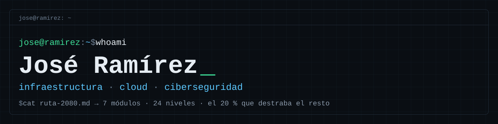
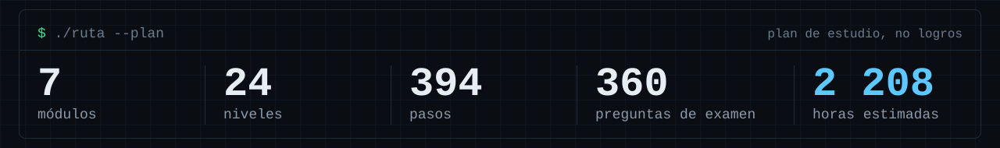

<p align="center">
  
</p>

```console
$ ./estado --resumen
rol            analista de infraestructura
foco           ciberseguridad defensiva · cloud (Azure, AWS) · infraestructura
trabajo diario Microsoft 365 · Entra ID · Intune · NOC · gestión de cambios (RFC)
formación      ITLA
idiomas        español · inglés técnico (en estudio)
laboratorios   5 planificados · se publican al cerrar cada nivel de la ruta
```

## > ruta de aprendizaje

Mi plan de estudio es abierto: **[Ruta 20/80](https://jose-m-ramir3z.github.io/ruta-2080/)**.
Cada módulo empieza por el 20 % que destraba el resto y sube hasta especialista. Cada nivel cierra con puertas de salida demostrables y un examen de selección múltiple.

<p align="center">
  
</p>

<sub>Cifras del plan, no de logros. Las horas son estimaciones propias.</sub>

## > mapa de habilidades

| Módulo | Dónde estoy | Hacia dónde voy |
| --- | --- | --- |
| Microsoft 365, Entra ID, Intune | Trabajo diario | Identidad híbrida y gestión de endpoints a escala |
| Infraestructura (redes, Windows, Linux) | En práctica | Administración de servidores y automatización |
| Ciberseguridad | En estudio, con laboratorios | Detección, hardening y respuesta a incidentes |
| Cloud (Azure y AWS) | En estudio | Diseño seguro y gobierno |
| Soporte técnico (hardware, arranque, memoria) | En práctica | Causa raíz y automatización |
| Inglés técnico | En estudio | Comunicación profesional (B2 a C1) |
| Bases de datos y desarrollo | Nivel fundamental | Leer, automatizar y hablar con desarrollo |

## > laboratorios

Un repositorio por laboratorio, con la misma estructura: objetivo, entorno, pasos, evidencia, mitigación y lecciones.
Los siguientes están **planificados** para el primer nivel; los marco al publicarlos.

| Laboratorio | Módulo | Estado |
| --- | --- | --- |
| Servidor Linux con SSH por clave | Infraestructura | Planificado |
| Captura con Wireshark de una consulta DNS y una petición HTTP | Infraestructura | Planificado |
| Inspección de un Windows de laboratorio con PowerShell | Ciberseguridad | Planificado |
| Mapa de memoria virtual de Windows con RAMMap | Soporte técnico | Planificado |
| Una VM en Azure y AWS con control de costos | Cloud | Planificado |

## > certificaciones

En preparación: AZ-900, AWS Cloud Practitioner, Network+ y Security+.

---

<sub>Los laboratorios se hacen en mi propio entorno de pruebas. No publico datos ni configuraciones de ninguna empresa.</sub>
